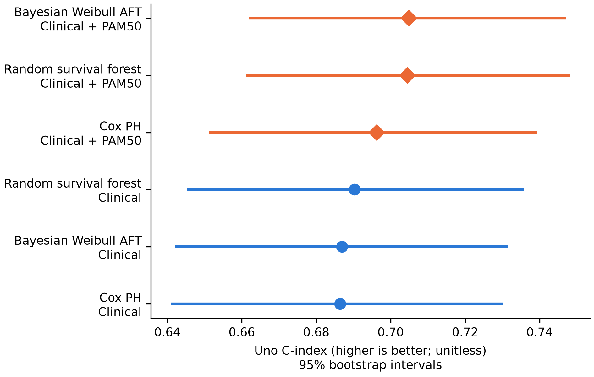
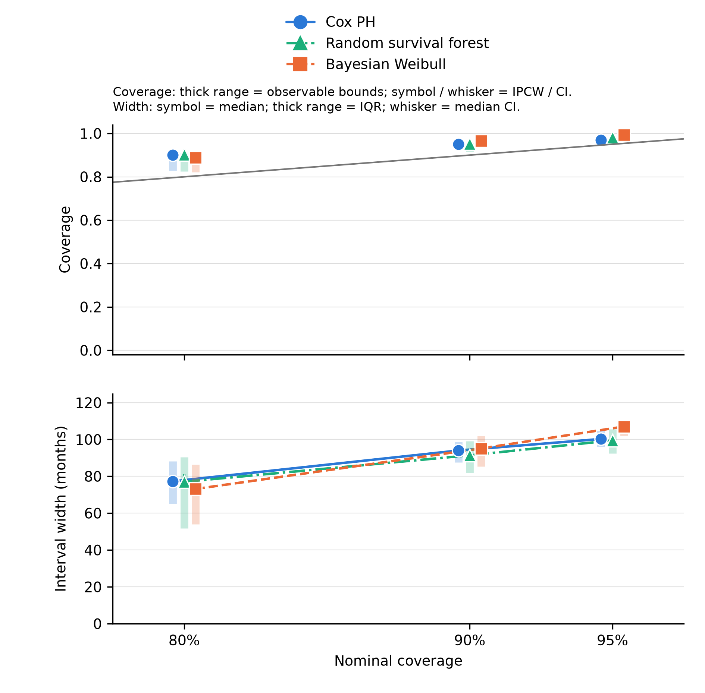

# Breast cancer survival uncertainty

How well do breast cancer survival models predict, and how informative are their uncertainty
intervals when follow-up is censored? This master's thesis project studies that question using
the public clinical portion of METABRIC. It compares Cox proportional hazards, Bayesian Weibull
accelerated failure time (AFT), and Random Survival Forest models, then evaluates survival
prediction intervals at 80%, 90%, and 95% nominal coverage.

The planned analysis has been implemented as an **internal validation study**. Selected
aggregate results and figures are published in [Results](docs/results/README.md).
Patient records, individual predictions, and fitted model objects are not in this
repository. A clean-commit numerical
reproduction of the published run has not yet been signed off.

## Study design

| Component | Design |
| --- | --- |
| Cohort | 1,979 eligible METABRIC patients from public cBioPortal clinical tables |
| Outcome | Breast-cancer-specific survival (DSS) primary; overall survival (OS) sensitivity |
| Frozen split | 989 training, 495 calibration, 495 test patients; stratified by DSS event |
| Predictors | Age, tumour size and grade, positive nodes, ER/PR/HER2; compared with those same variables plus the supplied PAM50 label |
| Models | Cox PH, Bayesian Weibull AFT, and untuned Random Survival Forest; 12 primary fits across outcomes and predictor sets |
| Prediction target | Restricted event time `min(T, τ)`, with τ = 300 months and a prespecified 120-month sensitivity analysis |
| Evaluation | Uno's C, Brier score, integrated Brier score, time-dependent AUC, and interval coverage **with width** |

I use the same patient split for every model and predictor set. Preprocessing is fitted on
training patients; conformal thresholds use calibration patients; the held-out test set is
used for evaluation. The [analysis decisions](docs/analysis-decisions.md) explain the endpoint,
missing-data, subtype, and follow-up choices. The [experimental design](docs/experimental-design.md)
and [methods](docs/conformal-methods.md) describe the split and censoring adaptation.

The primary conformal analysis uses a conservative score envelope for restricted survival
time. Because event times are unknown for censored patients, results show observable coverage
bounds, interval width, and inverse-probability-of-censoring-weighted (IPCW) coverage only
where the training data support it. These are population-level assessments under stated
assumptions, not individual clinical guarantees. A [Qin bootstrap comparator](docs/qin-exploratory.md)
and [one-sided lower-bound/ridge sensitivity](docs/uncertainty-reliability.md) were added
**after** the primary test analysis; they remain exploratory.

## Selected findings

For primary DSS discrimination, the paired change in Uno's C from adding PAM50 was modest:

| Model | Clinical | Clinical + PAM50 | Paired difference (95% CI) |
| --- | ---: | ---: | ---: |
| Cox PH | 0.686 | 0.696 | 0.010 [-0.005, 0.026] |
| Random Survival Forest | 0.690 | 0.705 | 0.014 [0.003, 0.025] |
| Bayesian Weibull AFT | 0.687 | 0.705 | 0.018 [0.003, 0.032] |

The Cox difference includes zero. The comparisons are exploratory, without multiplicity
adjustment, and better discrimination does not imply more useful uncertainty intervals.
The [training-only PAM50 survival curves](docs/results/figures/training_disease_specific_pam50_subtype_km.png)
provide descriptive cohort context; few patients remain at risk late in follow-up.



[Vector PDF](docs/results/figures/rq1_rq2_rq3_disease_specific_uno_c.pdf)

At 90% nominal coverage and the 300-month primary horizon, median DSS interval widths range
from **270.8 to 274.4 months** across the six model arms. The intervals are therefore broad
relative to the target range. For the Cox model with PAM50, observable coverage bounds and
median width at 90% nominal coverage are **92.9–95.4% and 94.0 months** at 120 months,
versus **92.5–95.2% and 273.1 months** at 300 months. These are identification bounds,
not confidence intervals. DSS censoring support at 300 months is too weak for the
registered IPCW coverage estimate; the report does not substitute a number there.



[Vector PDF](docs/results/figures/rq5_coverage_vs_nominal__disease_specific__clinical_molecular__conservative__horizon120.pdf)

The [primary results report](docs/results/thesis_results.md) gives the full model, metric,
coverage, and subgroup tables. The [exploratory reliability report](docs/results/reliability_comparison.md)
compares the later methods on the reused test set; it cannot validate a newly selected
primary method. A [hypothetical Bayesian profile](docs/results/figures/rq4_hypothetical_uncertainty_reference.png)
illustrates posterior and predictive uncertainty; it is not an individual forecast.

## Run the pipeline

The project uses Python managed by `uv`. The public clinical tables can be downloaded, but
the original patient-level snapshot and full generated outputs are not redistributed here.
Compute-heavy fitting, calibration, evaluation, and full tests run through SLURM:

```bash
make setup
make download
mkdir -p logs
sbatch scripts/slurm/run_pipeline.sh config/default.yaml
```

Use `sbatch scripts/slurm/run_stage.sh check` for lint and fast tests, and `make help` for
individual targets. The [pipeline runbook](docs/pipeline-runbook.md) and
[SLURM guide](docs/slurm-guide.md) cover stage-by-stage execution, manifests, and cluster
resources. Exact numerical reproduction of the published run requires matching its archived
raw snapshot, source/config hashes, and dependency lockfile; a fresh download alone does not
establish that match.

| Path | Contents |
| --- | --- |
| `config/` | Analysis settings, seeds, horizons, and exploratory configurations |
| `src/brca/` | Data preparation, survival models, conformal methods, evaluation, and figures |
| `scripts/` | Pipeline stages, audits, exports, and SLURM launchers |
| `tests/` | Synthetic-data tests; no real patient records |
| `docs/` | Design, methods, data dictionary, runbook, and selected aggregate results |
| `data/`, `outputs/` | Local inputs and generated artifacts, ignored by Git apart from a raw-data checksum manifest |

The [data dictionary](docs/metabric-data-dictionary.md) records the cBioPortal source and
METABRIC references. This is prognostic research on one historical cohort, not a clinical
decision tool. Its main limitations are the single internal split, no external validation,
possible dependent censoring, departures from proportional hazards, and weak support late
in follow-up.
