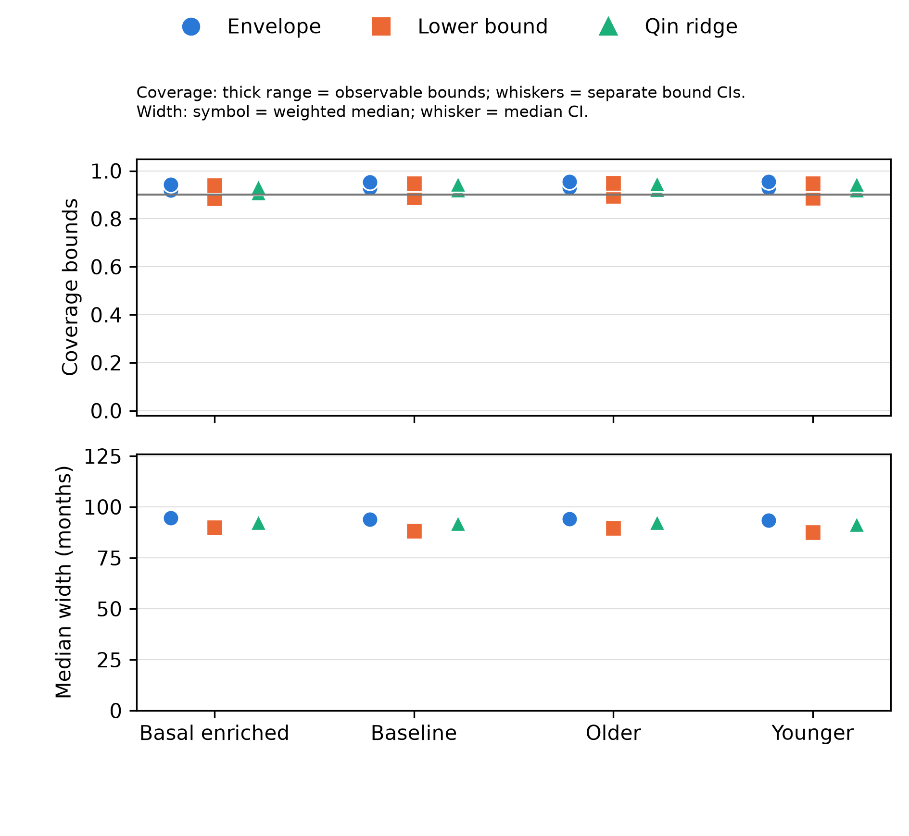

# Distribution-shift stress test

The original METABRIC models and conformal calibrations were held fixed while
the 495 test patients were reweighted toward younger age, older age or Basal
subtype. These are hypothetical changes in patient mix, evaluated after the
primary test analysis. They do not add an independent cohort.

For the declared display—breast-cancer-specific survival, Cox with clinical
predictors plus PAM50, 90% nominal coverage and a 120-month restricted target—the
stored aggregate estimates are:

| Patient mix | Observable coverage bounds | Median interval width | Effective sample size |
| --- | ---: | ---: | ---: |
| Original test mix | 92.9–95.4% | 94.0 months | 495 |
| Younger tilt | 92.9–95.5% | 93.4 months | 404 |
| Older tilt | 93.1–95.4% | 94.1 months | 408 |
| Basal subtype doubled | 91.9–94.2% | 94.5 months | 457 |

The changes are modest for this model and these specified shifts. The intervals
remain broad relative to the 120-month target. Under Basal enrichment, the 95%
bootstrap confidence interval for the **lower coverage bound** extends from 89.2%
to 94.4%; this does not establish that population coverage remains at least 90%.
The displayed coverage range itself is an identification bound caused by
censoring, not a confidence interval.

The [complete aggregate JSON](distribution_shift/distribution_shift.json) includes
all model families, both feature sets, both endpoints, three nominal levels, two
horizons and every scenario (168 interval settings, 672 scenario summaries). It
records widths alongside coverage, bootstrap status and effective sample size.
There was no correction for selecting among many exploratory comparisons.

[Vector PDF](distribution_shift/shift_dss_coverage_width.pdf) ·
[Method and reproduction details](../distribution-shift.md)
